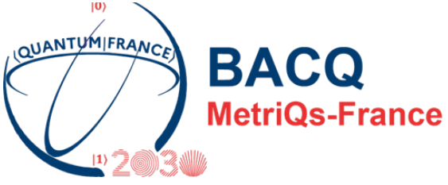

# BACQ-PS-QBCS — Quantum computer benchmark based on a quench in the BCS model

A benchmark for quantum processors based on simulating the quench dynamics of the
Bardeen–Cooper–Schrieffer (BCS) model.

The benchmark evaluates the maximum circuit depth for accurate quantum simulation.
It uses error mitigation based on randomized compiling and noise-estimation circuits.
Comparing the results using different error-mitigation schemes enables insight into 
the origin of noise on a quantum computer.

The benchmark runs on a
**local Qiskit/Aer simulator** and on **real QPUs**:
- IBM, via [IBM Quantum Platform](https://quantum.cloud.ibm.com/)
- IQM, via [IQM Resonance](https://resonance.iqm.tech/)
- IQM [Euro-Q-Exa](https://www.eurohpc-ju.europa.eu/eurohpc-quantum-computers/our-quantum-computers_en#euro-q-exa) (EQE1) at [LRZ](https://www.lrz.de/en/)
- IQM [VLQ](https://www.eurohpc-ju.europa.eu/eurohpc-quantum-computers/our-quantum-computers_en#vlq) at [IT4I](https://www.it4i.cz/en)
- AQT [PIAST-Q](https://www.eurohpc-ju.europa.eu/eurohpc-quantum-computers/our-quantum-computers_en#piast-q) at [PCSS](https://www.psnc.pl/)

Based on:

> *Mitigating crosstalk errors by randomized compiling: Simulation of the BCS model
> on a superconducting quantum computer*
> H. Perrin, T. Scoquart, A. Shnirman, J. Schmalian, K. Snizhko, [Phys. Rev. Research **6**, 013142 (2024)](https://journals.aps.org/prresearch/abstract/10.1103/PhysRevResearch.6.013142), [arXiv:2305.02345](https://arxiv.org/abs/2305.02345).

## Getting started

- [QUICK_START_Windows.md](QUICK_START_Windows.md) / [QUICK_START_Linux.md](QUICK_START_Linux.md): the shortest path from a fresh clone to runs on every QPU.
- [USER_MANUAL.md](USER_MANUAL.md): the full documentation (setup, pipeline, configuration, post-processing, tests).
- [GUIDE_FOR_ADDING_NEW_BACKENDS.md](GUIDE_FOR_ADDING_NEW_BACKENDS.md): how to add a new QPU machine or service.
- [GUIDE_FOR_ADDING_NEW_DUMMY_QPUS.md](source/benchmark_scripts/local_simulation_scripts/GUIDE_FOR_ADDING_NEW_DUMMY_QPUS.md): how to add a dummy noisy emulator of a QPU the benchmark was not run on.

## Repository tree

```
.
├── source/                          # all code
│   ├── core/                        #   the library: pipeline, circuit construction, run records, QPU access, analysis
│   ├── analysis_scripts/            #   post-processing and plotting scripts
│   ├── benchmark_scripts/           #   the benchmark: local simulation (with the dummy noisy emulators and their guide) and one folder per real QPU
│   └── tests/                       #   the pytest suite
├── calibration_input_files/         # provider calibration files when the QPU interface does not provide calibration data automatically
├── tokens/                          # provider API tokens and access files (git-ignored except README.md)
│   └── README.md                    #   lists every token file, with its format and where to obtain it
├── venvs/                           # create all virtual environments here; contains requirements for the base environment
├── datafiles/                       # created by the runs: run folders and circuit caches
├── analysis/                        # created by the post-processing: plots and summaries (the whole folder is git-ignored; its tests/ holds the test suite's output)
├── USER_MANUAL.md                   # the full user manual
├── QUICK_START_Windows.md           # step-by-step guide from a fresh clone to QPU runs (Windows)
├── QUICK_START_Linux.md             # the same for Linux/macOS
├── GUIDE_FOR_ADDING_NEW_BACKENDS.md # steps for adding a QPU machine or service
├── LICENCE.txt                      # the EUPL v. 1.2 licence text
├── _images/                         # images used by the docs
└── README.md                        # this file
```

Provider API tokens are never committed: each one is a file `tokens/<provider>_token`, as listed in
[tokens/README.md](tokens/README.md).

## About the BACQ project

<p align="center">
  
</p>

BACQ-PS-QBCS is a benchmark of the [BACQ project](https://www.lne.fr/en/metriqs-france/projet-bacq).
BACQ is part of the MetriQs-France program and is supported by the France 2030 program under the
French National Research Agency (ANR) grant number ANR-22-QMET-0002.

## Authors

The code was developed by Sidhartha Dash ([ORCID](https://orcid.org/0000-0003-2516-5277)) and
Kyrylo Snizhko ([ORCID](https://orcid.org/0000-0002-7236-6779)), with help from Claude
(Sonnet and Opus models of various versions).

## Acknowledgements

We thank the EuroHPC personnel at PCSS, IT4I and LRZ, and the IQM representatives, for their help with
the technicalities of QPU access and for helping ensure that the benchmark was executed on the QPUs as intended.

## License

The code is distributed under the [European Union Public Licence (EUPL) v. 1.2](https://interoperable-europe.ec.europa.eu/licence/european-union-public-licence-version-12-eupl).
The full licence text is in [LICENCE.txt](LICENCE.txt).
